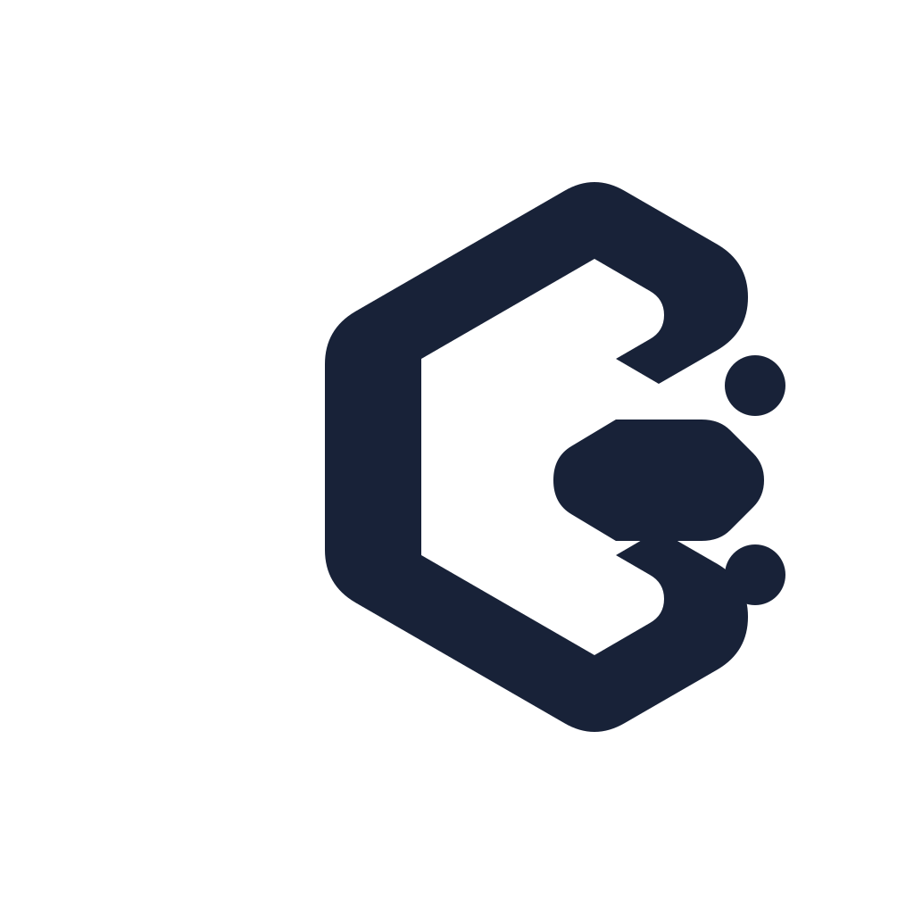
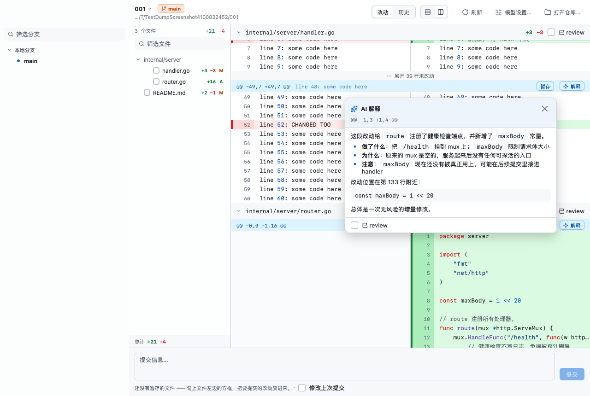

<p align="center">
  <picture>
    <source media="(prefers-color-scheme: dark)" srcset="resources/logo-dark.svg">
    <source media="(prefers-color-scheme: light)" srcset="resources/logo.svg">
    
  </picture>
</p>

<h1 align="center">Gloss</h1>

<p align="center">
  <strong>原生 macOS Git 客户端 · 每个变更块都有 ✨ AI 逐块解释</strong><br>
  <em>A native macOS Git client with inline AI hunk explanations — Pure Go, GPU Direct Rendering, Zero WebViews.</em>
</p>

<p align="center">
  <a href="https://go.dev/"></a>
  
  <a href="https://github.com/egoist/mygo"></a>
  
  
</p>

<p align="center">
  <picture>
    <source media="(prefers-color-scheme: dark)" srcset="resources/screenshot-dark.png">
    <source media="(prefers-color-scheme: light)" srcset="resources/screenshot-light.png">
    
  </picture>
</p>

---

## 为什么是 Gloss？

日常 Review 别人（或者 AI 助手）写的大量改动代码时，最痛苦的不是看 diff，而是**看不懂这几行具体在解决什么、意图是什么、有没有暗坑**。

Gloss 是一款专注于**高效代码阅读与安全 Git 操作**的原生 macOS 客户端：
- **哪里不懂点哪里**：每个变更块（hunk）边上都有独立 ✨ 解释按钮，AI 用人话讲清这段增删改动“做了什么、为什么做、有没有潜在风险”。
- **纯粹的原生极速**：用 [mygo](https://github.com/egoist/mygo) 编写，GPU 直接绘制，**没有 webview、没有 JS 运行时、单个二进制文件**，启动如闪电，滚动丝滑。

---

## 核心特性

- ⚡ **原生 GPU 直绘**：零 Web 框架开销，极低内存占用，对齐 GitHub 视觉美学与 macOS 原生体验。
- ✨ **逐块 AI 解释（悬浮卡片）**：流式输出、不挤动 diff 排版。精准携带真实行号上下文，只针对当前 hunk 深度拆解，支持缓存去重。
- 🌲 **Fork 式上下分 & 拓扑图**：自研提交拓扑图，直观梳理分支合并脉络；下半区分立文件树与详细 diff。
- 🔍 **Viewed 联动折叠**：标记已 review 的文件在 diff 中自动折叠，一屏扫完未审阅代码，文件变动标记自动失效。
- 🛠 **硬核 Git 工作流**：
  - **暂存与提交**：支持文件级暂存与**按块暂存（Hunk Staging）**、保留草稿、修改上次提交（`--amend`）。
  - **分支与远程**：一键切换/新建/重命名/删除分支，安全合并与变基，带 `--force-with-lease` 租约保护的强制推送。
  - **储藏管理（Stash）**：清晰查看储藏改动 diff，安全应用（Apply）、取出（Pop）与带确认的丢弃（Drop）。
- 🦺 **错误与冲突全说人话**：
  - 拒绝冷冰冰的 git 报错：钩子拦截、锁文件、凭证异常皆有人话指引与解决建议，保留原话备查。
  - 变基/合并冲突时弹出醒目琥珀色状态条，支持文件逐个双向挑边、智能提示删除变更、安全中止二次确认。
- ⌨️ **全键盘流 & 全局命令栏**：`⌘K` 调出命令栏，`J` / `K` 快捷跳转改动块，常用操作全局快捷键覆盖。
- 🤖 **全模型兼容**：内置 Anthropic / DeepSeek / Kimi(Moonshot) / 通义千问 / 智谱 GLM / OpenRouter / Ollama 预设，兼容任何 OpenAI 兼容端点。

---

## 功能详述

- **本地 git 仓库**：打开一个工作副本，看未提交的改动；侧栏列着分支 / 远程 / 标签 / 储藏，点一条分支就只看它的历史，点一条储藏直接看它的改动。
- **暂存与提交**：文件行左边的方框按整个文件暂存，hunk 头上的按钮按块暂存 —— 改动因此分成「已暂存 / 未暂存」两段，同一个文件可以两边各占一份；提交栏里写信息（`⌘⏎` 提交），写了一半的消息按仓库记着，切走再回来还在。
- **切分支 / 检出 / 打标签**：侧栏里的分支和标签双击就是检出，右键菜单也可以（菜单文案会把去向写全：「检出标签 v1（分离 HEAD）」）；远程分支会顺便建一条本地分支并设好上游，本地已有同名分支时降级为切过去。检出标签之后工具栏那枚分支芯片换成警示色 —— 分离 HEAD 上提交会成为游离提交，得先说出来。
- **分支集成与远程管理**：
  - 本地分支右键：支持「把 `<分支>` 合并进当前分支」与「把当前分支变基到 `<分支>`…」（变基会改写提交历史，执行前带风险说明二次确认；若遇冲突自动切入琥珀色 PendingBar 解决）。
  - 远程分支右键：支持直接检出跟踪分支，或通过「删除远程分支 `<remote>/<name>`…」从远端安全删除分支（带确认弹窗与人话错误翻译）。
  - 标签右键：一键推送到远程 `origin`。
  - 远程菜单与命令栏：新增「强制推送（--force-with-lease）…」，仅在当前分支配有上游且非分离 HEAD 时可用，弹窗确认提示 `--force-with-lease` 租约保护机制，安全防止冲掉协作者的新提交。
- **打标签**：历史里右键一个提交 → 名称 + 说明（附注标签）或只给名字（轻量标签）。重名、名字非法这些错误留在对话框里，名字和说明一个字都不丢。
- **储藏管理与修改上次提交**：
  - **储藏（Stash）**：菜单「文件 → 储藏工作区改动…」或命令栏唤起模态对话框，支持备注说明与是否包含未跟踪文件（`-u`）；干净工作区保存时人话阻断提示；侧栏储藏分组单击查看完整 diff，右键支持应用（Apply）、取出并丢弃（Pop）、丢弃（Drop，带二次确认与说明回显）、复制储藏名。
  - **修改上次提交（Amend）**：提交栏常驻「修改上次提交」复选框，开启后自动拉取并预填上一次提交信息，支持零暂存改动下纯改提交信息，或合并新暂存改动至上次提交。
- **远程：抓取 / 拉取 / 推送**：工具栏三颗图标 —— 抓取只更新远程分支、不动工作区；拉取把远程的提交合进来；推送发出去，第一次推会自动建好上游（`-u origin <分支>`）。仓库没有远程时这三颗根本不画（`git fetch --all` 在没有远程时是**静默成功**的，灰按钮等不到任何解释）；分离 HEAD 上拉取和推送变灰，悬停会说清为什么。失败照样说人话：推送被拒、分支分叉、连不上、要登录各有各的说法 —— 我们没有凭证输入 UI，凭据类失败会明确指向「在终端里登录一次」。
- **GitHub 风格 diff 视图**：红增绿删、双侧行号、语法高亮（chroma）、文件树导航。
- **逐块 AI 解释（悬浮卡片）**：每个 hunk 一个 ✨ 按钮，点开是贴着按钮弹出的浮窗，流式输出、不挤动 diff。一个文件有多个变更块时，prompt 会点名「当前是第几个块」并列出其它块的位置，文件上下文带真实行号，解释只讲这一个块。失败时不甩一坨 HTTP 错误：说清是什么事、怎么办（密钥不对直接给一条「模型设置…」），供应商的原话留着可查。
- **Fork 式的上下分**：主区上半是提交列表（左边一条自己算的提交拓扑图），下半左边是文件列表、右边是选中提交的 diff；点文件列表里的一行，diff 直接滚到那个文件的头上。
- **文件树**：可折叠的目录树（只含一个子目录的目录链合并成一行）、模糊筛选（`⌘F`）、每行右侧 `+N −N` 和状态字母、底部一条常驻栏脚写着总计和已 review 进度。
- **Viewed 联动折叠**：标了 `已 review` 的文件在 diff 里折成一条文件头，一屏就能扫完剩下的改动；内容一变标记自动失效。点文件头可以手动折叠/展开。
- **写操作说人话**：暂存 / 提交失败时顶上一条横幅 —— 出了什么事、能怎么办、git 自己的原话（钩子拦下、`index.lock`、没配 user.name、GPG 签名失败……都有对应的说法），原话永远留着可查。
- **停在冲突里也有出路**：合并 / 变基 / 拣选 / 回退 / 补丁序列停在半路时，顶上一条琥珀色状态条 —— 还剩几个冲突文件、接着「继续」还是「跳过」，不做了就「中止」（会先把「已经解决的部分也要重来一次」说清，问一句再动手）。它和红色的失败横幅分开伺候：横幅说的是「刚才那一下出了什么事」，读完自己关掉；状态条说的是「仓库现在什么状态」，事情没了结它不消失。变基期间工具栏的分支芯片改口报「正在变基 topic → main（第 1/2 步）」而不是喊「分离 HEAD」；储藏 apply/pop 撞出来的冲突没有可继续的步骤，状态条只叙述、不摆按了会落空的按钮。
- **冲突文件逐个解决**：打开冲突文件，diff 位置是一张卡片 —— 一句白话说清处境，两颗按钮挑边（变基里说「用变基目标的 / 用重放中的」，变基的两边和合并正好相反，照合并的习惯写「用我这边的」，点下去拿到的是别人的代码）；文件行右键同样能挑，外加「在编辑器打开」和「标记为已解决」，文件栏栏脚数着还剩几个。对方删了文件时卡片会**提前说明「这一按是接受删除」**；已经解决过的文件再点会得到一句「这个文件已经没有冲突了」并重读列表，而不是拿旧状态静默覆盖。
- **命令栏（`⌘K`）**：所有功能都能键盘调到。
- **多供应商配置**：内置 Anthropic / DeepSeek / Kimi(Moonshot) / 通义千问 / 智谱 GLM / OpenRouter / Ollama 预设，任何 OpenAI 兼容接口都可用；也支持 `ANTHROPIC_API_KEY` 环境变量回退。
- **结果缓存与持久化**：同一个变更块（按内容哈希 + 模型名）不重复调用模型；解释、已 review 状态、窗口设置都存在 `~/Library/Application Support/Gloss/`。

---

## 快捷键

| 快捷键 | 作用 |
|---|---|
| `⌘K` | 命令栏 |
| `J` / `K` | 跳到下一段 / 上一段改动 |
| `⌘F` | 聚焦文件筛选框 |
| `⌘⏎` | 提交（输入框里回车是换行，所以带 `⌘`） |
| `⌘O` | 打开仓库 |
| `⌘1` / `⌘2` | 改动 / 历史 |
| `⌘⇧B` | 收起 / 展开侧栏 |
| `⌘R` | 刷新 |
| `⌘⇧F` / `⌘⇧P` / `⌘⇧U` | 抓取 / 拉取 / 推送 |
| `⌘+` / `⌘−` / `⌘0` | 代码字号放大 / 缩小 / 恢复默认 |
| `⌘,` | 模型设置 |
| `Esc` | 关掉解释卡片、确认框 |

> 菜单栏（`menu.go`）里每一项都带着同一个快捷键：真实 macOS 应用里原生菜单会先把键吃掉，视图那条路走不到，两处的按键映射保持一致。

---

## 构建与运行

需要 **Go 1.27+**（mygo 的硬要求，`mise.toml` 里已经预设好）。

```bash
# 1. 安装指定版本环境
mise install                 # 装 Go 1.27.1

# 2. 本地开发调试（改动自动重载）
go tool mygo dev             # 开发模式，改完自动重启

# 3. 生产打包
go tool mygo build           # 出 .app 和 .dmg（build/darwin-arm64/）

# 4. 自动化测试
go test ./...                # 界面是无头的，测试不需要物理开窗口
```

---

## 配置模型

界面右上角「模型设置…」里添加一个供应商即可。API key 保存在 `~/Library/Application Support/Gloss/config.json`（权限 0600）。

若未在 UI 中配置，会自动回退读取环境变量：

```bash
export ANTHROPIC_API_KEY=sk-ant-...
# 可选：export ANTHROPIC_MODEL=claude-sonnet-5-5
# 可选：export ANTHROPIC_BASE_URL=https://...   # 中转/代理地址
```

---

## 源码架构

```
main.go / app.go         窗口、菜单、app 状态、每帧的根布局
  sidebar.go             侧栏：分支 / 远程 / 标签 / 储藏树
  branchops.go           分支与远程操作：合并、变基、删除分支、删除远程分支、推送标签、强制推送
  renamebranchdialog.go  重命名分支（名称体检与当前分支更新）
  stashdialog.go         储藏对话框（保存未提交改动至储藏栈）
  stashops.go            储藏操作：应用、取出、丢弃确认
  history.go             上半区：提交列表 + 列头
  commitops.go           提交行右键：拣选 / 回退 / 检出（分离 HEAD）/ 复制哈希
  resetdialog.go         重置当前分支（软·混合·硬三档说明 + 丢弃改动告警）
  newbranchdialog.go     从选定提交建分支（名称体检 + 可选建好就切过去）
  graph.go               提交拓扑图：布局（buildGraph）与逐行绘制
  filepane.go            下半区左边：文件列表（含暂存勾选框）
  diffview.go            diff 渲染、语法高亮、折叠
  commitbox.go           暂存勾选框、hunk 暂存按钮、提交栏（含修改上次提交）
  checkout.go            检出：右键菜单文案、双击、检出后的收尾
  tagdialog.go           打标签对话框（名称 / 附注 / 说明）
  remote.go              远程：工具栏那三颗图标、抓取 / 拉取 / 推送的入口
  opbanner.go            写操作的结果：失败横幅 / 成功 Toast
  pendingbar.go          卡在冲突里的琥珀状态条：继续 / 跳过 / 中止
  confirmdialog.go       动手前先问一句（中止合并这类不可逆操作）
  resolve.go             冲突文件逐个解决：挑边的按钮文案、卡片、右键菜单
  treeview.go            两棵树共用的行画法（缩进 / 箭头 / 选中胶囊）
  refs.go                引用树的分组与筛选
  rows.go                扁平行模型（虚拟化列表的数据源）
  explain.go             ✨ 卡片：定位、流式节流、缓存
  palette.go / keys.go   命令栏、快捷键
  menu.go                菜单栏：同样那批命令，键和 keys.go 一一对应
  settings.go            模型设置对话框
  theme.go               配色（对齐 GitHub 那套）

internal/
  gitrepo/               git CLI 封装（status / diff / log / refs / 写操作）
    write.go             暂存、按块暂存、提交与修改上次提交（--amend）
    stash.go             储藏操作（push / apply / pop / drop）
    commitops.go         拣选、回退、重置（--soft / --mixed / --hard）
    branch.go            新建、重命名、删除分支、合并（--no-edit）、变基
    remote.go            抓取 / 拉取 / 推送（含 --force-with-lease、push tag、delete remote branch）
    pending.go           探测停在哪种操作中间 + 继续 / 跳过 / 中止
    conflict.go          冲突文件挑边（ours/theirs、删除-修改走 rm）+ stage 探测
    failure.go           把 git 的错误翻成人话（说什么事 / 怎么办 / 原话留着）
  diff/                  unified diff 解析
    slice.go             从完整 patch 里原样切出一段（按块暂存要用）
  highlight/             chroma：整文件 tokenize 后按行切片
  explain/               prompt 构建、上下文窗口（纯函数，不碰网络）
  llm/                   Anthropic + OpenAI 兼容接口的流式客户端
    failure.go           把供应商的错误翻成人话（说什么事 / 怎么办 / 原话留着）
  store/                 config / state / cache 持久化
  filetree/              树的构建、摊平与模糊筛选（侧栏和文件列表共用）
```

> **线程约定**（详见 `app.go` 顶部）：只有主线程读写 app 的字段，后台 goroutine 只收值参数、结果一律走 `dispatch` 回主线程调度。

---

## 后续路线

- [x] 暂存 + 提交（文件级 + hunk 级）
- [x] 切分支 / 检出标签 / 打标签（双击 + 右键菜单）
- [x] 远程：fetch / pull / push
- [x] 停在冲突里：状态条 + 继续 / 跳过 / 中止（中止前确认）
- [x] 冲突文件逐个解决：用我这边 / 用对方那边 / 在编辑器打开 / 标记为已解决
- [x] 提交右键：拣选 / 回退 / 重置（软·混合·硬）/ 从这里建分支 / 复制哈希
- [x] 本地分支管理：新建（快捷键 ⌘⇧N / 菜单 / 提交行）/ 重命名 / 删除（未合并两段确认）
- [x] 远程分支与分支集成：删除远程分支，merge / rebase 进当前分支，force-with-lease 强推，推标签
- [x] 储藏管理与提交修正：储藏工作区改动（可选说明与未跟踪文件）、侧栏储藏右键（apply / pop / drop 确认），提交栏「修改上次提交」（--amend，预填上次提交信息）
- [ ] 侧栏可拖宽
- [ ] 提交列表的键盘上下选择（`J` / `K` 现在只在 diff 里跳）
- [ ] GitHub PR：直接看 PR 的 diff、把解释回写成评论
- [ ] 风险预扫：AI 预扫全量 hunk，可疑变更标红
- [ ] 单行级解释 / 选中追问
