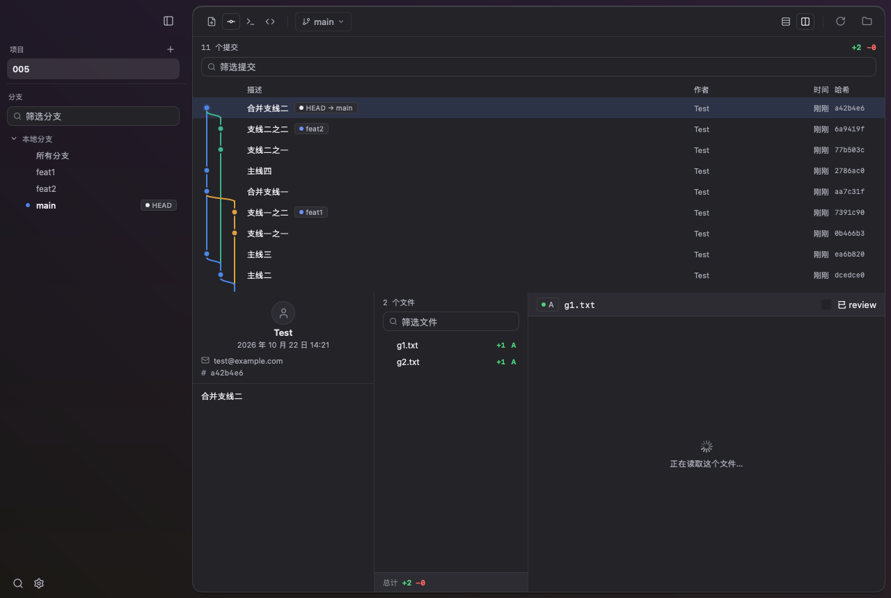
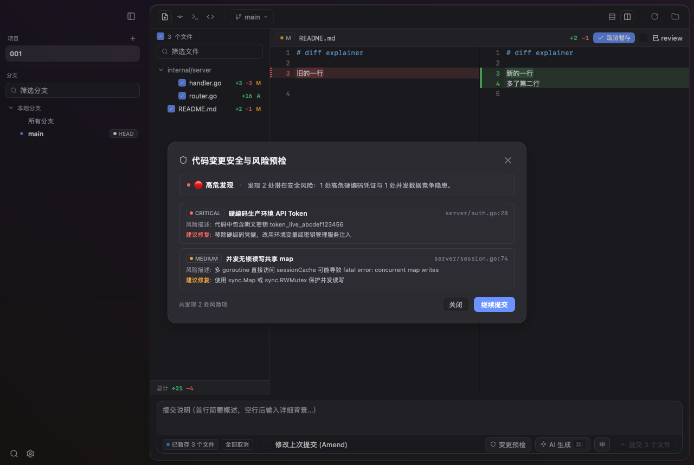
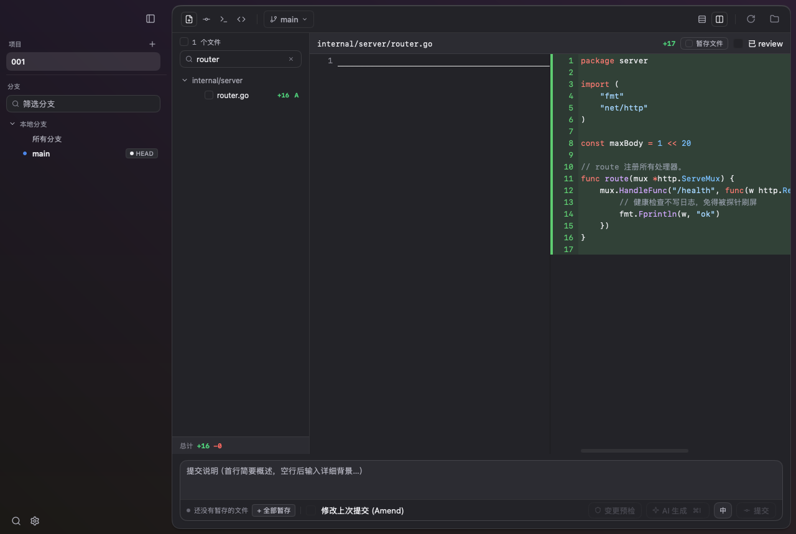

<p align="center">
  <picture>
    <source media="(prefers-color-scheme: dark)" srcset="resources/logo-dark.png">
    <source media="(prefers-color-scheme: light)" srcset="resources/logo.png">
    
  </picture>
</p>

<h1 align="center">Gloss</h1>

<p align="center">
  <strong>下一代高性能原生 Git 客户端 · AI 变更安全预检 · 智能提交辅助</strong><br>
  <em>纯 Go 编写 · GPU 直接绘制 · 零 WebView 架构 · ~20MB 单二进制</em>
</p>

<p align="center">
  <a href="https://github.com/CarlOpenLab/Gloss/releases/latest"></a>
  <a href="https://go.dev/"></a>
  
  <a href="https://github.com/egoist/mygo"></a>
  
  
  <a href="LICENSE"></a>
</p>

<p align="center">
  <a href="https://carlopenlab.github.io/Gloss/">🌐 官方网站</a> •
  <a href="https://github.com/CarlOpenLab/Gloss/releases">📦 下载安装包</a> •
  <a href="#核心特性">✨ 核心特性</a> •
  <a href="#快捷键指南">⌨️ 快捷键</a> •
  <a href="README.md">English</a> • 简体中文
</p>

---

<p align="center">
  <picture>
    <source media="(prefers-color-scheme: dark)" srcset="pages/assets/shot-history-dark.png">
    <source media="(prefers-color-scheme: light)" srcset="pages/assets/shot-history-light.png">
    
  </picture>
</p>

---

## 为什么选择 Gloss？

> **「先看清，再合并。」**

在 AI 辅助编程与自动化开发广泛普及的当下，代码改动的产出速度前所未有。日常审查大型 Pull Request 或本地工作区时，开发者最大的痛点往往不是逐行读代码，而是**看不懂这些代码背后的真实意图是什么、是否夹带了未经脱敏的密钥配置、是否存在潜在的注入漏洞或破坏性回归风险**。

市面上现有的 Git 图形客户端，要么是基于 Electron 打造的臃肿巨物——动辄占用数百兆内存、加载长 diff 时卡顿掉帧；要么是缺少现代 AI 协作与安全把控能力的传统工具。

**Gloss** 从零开始采用纯 Go 语言打造，致力于带来极致纯粹、轻快敏捷的原生桌面体验：

* **⚡ 原生 GPU 直绘引擎**：基于 [mygo](https://github.com/egoist/mygo) 构建，**零 WebView、零 JavaScript 运行时、零 Electron 依赖**。毫秒级冷启动（<100ms），60 FPS 丝滑滚动体验，单二进制文件仅约 20MB。
* **🛡️ 提交前 AI 变更安全预检**：一键预检暂存区的全量改动，由大模型深度分析硬编码凭证、SQL/命令注入、逻辑漏洞等高危隐患，按严重度（严重/高危/中危/低危）分级呈现，精确定位至文件与行号。
* **🤖 智能 Conventional Commits 与分支命名**：结合暂存改动与意图提示自动生成规范的提交信息；支持根据一句话需求描述一键生成标准分支名。
* **🌲 Fork 式分支拓扑与双栏代码审查**：自研 GPU 拓扑图直观展示分支交织历程；单文件聚焦视图、词级内联改动高亮、按块/按行暂存、图片差异对比与已审阅进度跟踪。
* **🦺 告别生硬报错，全面说人话**：摒弃冰冷的 Git CLI 错误代码或原始 HTTP 报错，钩子拦截、锁冲突、分支分叉皆有人话翻译与明确的操作解决指引。

---

## 核心特性

### 1. 提交前 AI 变更安全预检
在按下提交键之前，把隐患扼杀在摇篮里。点击提交栏的 **🛡️ 变更预检**，Gloss 会将暂存区的 diff 提交至大模型进行全量扫描，输出结构化审计报告，按 **严重 (Critical)**、**高危 (High)**、**中危 (Medium)** 与 **低危 (Low)** 明确标出风险，每条均锚定具体文件与行号。

<p align="center">
  
</p>

### 2. Fork 式分支拓扑与引用智能
自研高密度 GPU 绘制的分支拓扑图，清晰梳理复杂分支脉络：
* **全局「所有分支」视图**：一屏看全仓库内所有分支、远端跟踪与标签的汇聚历史，不再遗漏未合并的孤立支线。
* **上游状态实时跟踪**：有追踪关系的本地分支实时展示 `↑n ↓n` 超前/落后提交计数（单次高效批量拉取，零额外 rev-list 性能开销）；若上游在远端被移除，醒目标注「上游已删除」。
* **即时筛选过滤 (`/`)**：输入关键词即时对提交说明、哈希、作者与分支标签进行流式过滤，异步按需向下补全。
* **拓扑色谱自定义**：提供经典（Classic）、鲜艳（Vivid）与灰阶（Monochromatic）三套内置色系，深浅外观各支持 8 轨道逐色微调。

### 3. 精准代码审查与颗粒度暂存
采用单文件专注审查体验，消除多文件同时展开时的注意力涣散：

<p align="center">
  <picture>
    <source media="(prefers-color-scheme: dark)" srcset="pages/assets/shot-diff-dark.png">
    <source media="(prefers-color-scheme: light)" srcset="pages/assets/shot-diff-light.png">
    
  </picture>
</p>

* **词级内联差异高亮**：双侧行号、词级增删内联高亮、未改动区域折叠与语法高亮。
* **按块与行区间暂存（Hunk / Line Staging）**：光标悬停或选定代码段，点击即可单独暂存或撤销该块改动，无须为了微调改动手动分割 patch。
* **栅格图片差异审查**：原生支持 **PNG、JPEG、GIF、WebP、BMP** 栅格图像的前后对照预览，并清晰呈现尺寸、格式及文件体积变化。
* **已审阅状态跟踪（Viewed）**：点击标记文件为「已审阅」，列表项自动折叠灰显，文件内容变更后自动失效，审查进度一目了然。
* **差异内搜索 (`⌘F`)**：改动区内置查找栏，打字即时匹配，与文件名模糊搜索 (`⌘P`) 逻辑分离。

### 4. 内联冲突解决与安全工作流
* **可视化冲突消解**：在改动区直接展示带标记的冲突文本，提供「保留我们的 / 保留他们的 / 两个都保留 / 都不要」快捷挑边按钮；右侧代码区可直接手动编辑，点击「保存并标记已解决」一步完成写盘与 `git add`。
* **琥珀色操作状态条**：处于变基、合并或拣选冲突过程中时，顶部常驻醒目的琥珀色状态条，显示剩余冲突文件数，并提供「继续」、「跳过」与「安全中止」选项。
* **带租约的安全强推**：内置 `--force-with-lease` 强制推送保护，防止误覆盖团队成员刚刚推送的新提交。
* **本地与远端分支独立删除**：本地分支删除与远端分支删除严格拆分为独立动作，配备清晰的二次风险确认。

### 5. 内置终端与工作区全局探索
* **全工作区文件树**：内置编辑器模式左栏呈现工作区完整文件列表（`git ls-files`），并遵循 VS Code 规范根据 Git 状态对文件名与上级目录进行语义化着色。
* **Ghostty 驱动的内置终端**：支持为每个项目开启多个独立 Shell 终端标签页，支持 Nerd Font 等宽字体配置。
* **AI CLI 图片剪贴板直通**：直接向 Claude Code 等终端 AI CLI 粘贴图片（`⌘V`），自动转换剪贴板图片按键序列，顺畅配合多模态命令行工具。

### 6. 三层 Git 身份配置与多模型管理
* **Git 身份审查器**：在统一界面中集中管理 **系统级**、**全局级** (`~/.gitconfig`) 与 **项目级** (`.git/config`) 的 `user.name` 和 `user.email`。Gloss 采用微创保存机制，绝不破坏用户原本的注释、include 指令或自定义段落。
* **通用多大模型接入**：内置 **Anthropic Claude**、**OpenAI**、**DeepSeek**、**Kimi (Moonshot)**、**通义千问**、**智谱 GLM**、**OpenRouter** 以及本地 **Ollama** 预设，支持拖拽调整优先级排序。

---

## 下载与安装

各平台预编译包均可在 [GitHub Releases](https://github.com/CarlOpenLab/Gloss/releases/latest) 页面获取：

| 操作系统 | 文件格式 | 说明 |
| :--- | :--- | :--- |
| **macOS** | `.dmg` | 原生适配 Apple Silicon (`arm64`) 与 Intel (`x86_64`) 芯片 |
| **Windows** | `.exe` / `.zip` | 安装程序向导 或 便携免安装版（解压即用，无需管理员权限） |
| **Linux** | `tar.gz` | 便携式 64 位原生可执行文件 |

> [!NOTE]
> **Windows Defender 提示说明：**
> Microsoft Defender 的机器学习启发式规则偶尔会将新发行的、未代码签名的全新安装包报为 `Trojan:Script/Wacatac.C!ml`。Gloss 源代码完全透明，不包含任何压缩混淆或安装期外链下载。
> * **推荐方案**：直接下载 `gloss-<版本>-windows-amd64-portable.zip`，解压后直接双击 `Gloss.exe` 即可运行。
> * **或在 Defender 中放行**：打开「Windows 安全中心」→「保护历史记录」→ 找到拦截项 →「操作」→「允许在设备上」。

---

## 源码构建

构建 Gloss 需要 **Go 1.27+**（推荐通过 `mise` 自动管理版本）：

```bash
# 1. 克隆代码仓库
git clone https://github.com/CarlOpenLab/Gloss.git
cd Gloss

# 2. 安装指定版本的 Go 工具链
mise install

# 3. 启动开发模式（支持代码热重载）
go tool mygo dev

# 4. 生产打包（生成目标平台的二进制与安装包）
go tool mygo build

# 5. 执行无头自动化测试
go test ./...
```

---

## 快捷键指南

Gloss 遵循全键盘流设计哲学：

| 快捷键 (macOS) | 快捷键 (Win / Linux) | 功能说明 |
| :--- | :--- | :--- |
| `⌘K` | `Ctrl+K` | 唤起全局命令栏（Command Palette） |
| `J` / `K` | `J` / `K` | 在改动区跳转下/上一段差异，或在历史中移动选中提交 |
| `↓` / `↑` | `↓` / `↑` | 选择下/上一个文件（改动页）或提交（历史页） |
| `⌘F` | `Ctrl+F` | 在当前差异（Diff）中快速查找 |
| `↵` / `⇧↵` | `Enter` / `Shift+Enter` | 定位至下/上一个查找匹配项 |
| `⌘P` | `Ctrl+P` | 聚焦文件模糊搜索框 |
| `/` | `/` | 聚焦历史提交筛选搜索框 |
| `⌘S` | `Ctrl+S` | 保存已编辑内容（冲突文件会自动追加 `git add`） |
| `⌘⏎` | `Ctrl+Enter` | 提交暂存改动 |
| `⌘O` | `Ctrl+O` | 打开本地代码仓库 |
| `⌘1` / `⌘2` | `Ctrl+1` / `Ctrl+2` | 切换至 **改动** / **历史** 视图 |
| `⌘3` / `⌘4` | `Ctrl+3` / `Ctrl+4` | 切换至 **终端** / **编辑器** 视图 |
| `⌘⇧B` | `Ctrl+Shift+B` | 展开 / 收起侧边栏 |
| `⌘R` | `Ctrl+R` | 刷新仓库状态 |
| `⌘⇧F` | `Ctrl+Shift+F` | 抓取所有远程仓库（Fetch） |
| `⌘⇧P` | `Ctrl+Shift+P` | 从远程分支拉取合并（Pull） |
| `⌘⇧U` | `Ctrl+Shift+U` | 推送至远程分支（Push） |
| `⌘+` / `⌘-` / `⌘0` | `Ctrl++` / `Ctrl+-` / `Ctrl+0` | 界面字号放大 / 缩小 / 恢复默认 |
| `⌘,` | `Ctrl+,` | 打开设置面板 |
| `Esc` | `Esc` | 关闭查找栏或退出模态浮层 |

---

## 模型与配置

在应用内通过 **设置 (`⌘,` / `Ctrl+,`) → 模型设置** 即可添加并管理 AI 服务商；亦可通过标准环境变量无缝回退：

```bash
# Anthropic Claude 示例
export ANTHROPIC_API_KEY="sk-ant-..."
export ANTHROPIC_MODEL="claude-sonnet-4-5" # 可选

# OpenAI 或 兼容端点示例
export OPENAI_API_KEY="sk-..."
export OPENAI_BASE_URL="https://api.openai.com/v1" # 可选
```

配置文件存储在本地安全路径（权限严格限定为 `0600`）：`~/Library/Application Support/Gloss/config.json`（macOS）。

---

## 源码架构

```
Gloss/
├── main.go / app.go         窗口、原生菜单、应用状态机与主帧渲染调度
├── sidebar.go               侧边栏：本地分支、远程分支、标签与储藏树
├── history.go               上半区：提交列表、多列布局与选中态维护
├── graph.go                 自研 GPU 提交拓扑图算法与逐行绘制引擎
├── review.go                改动审查区：单文件 Diff、按块暂存与冲突消解
├── imagereview.go           栅格图片预览与差异对比引擎（PNG、JPEG、GIF、WebP、BMP）
├── commitbox.go             提交 Composer：暂存控制、修改上次提交与 AI 生成
├── workspace.go             编辑器视图：全量工作区目录树浏览
├── palette.go / keys.go     命令栏交互与全局快捷键映射
├── settings.go / theme.go   macOS 风格悬浮可拖拽设置面板与 GitHub 配色系统
├── gitconfig.go             三层 Git 身份配置查看与微创修改
└── internal/
    ├── gitrepo/             底层 Git CLI 封装（状态查询、Diff 解析、引用拉取、写入事务）
    ├── diff/                Unified Diff 解析器、切片分割与行区间补丁生成
    ├── llm/                 流式多供应商 AI 客户端（Anthropic、OpenAI、Ollama）
    ├── explain/             Commit 信息、分支名称与风险审计 Prompt 构建
    └── filetree/            支持模糊过滤的目录树结构实现
```

> [!IMPORTANT]
> **主线程并发约束**：所有针对应用状态的核心读写与 UI 变更均严格在主线程完成。耗时的后台 Git 事务或网络请求均在独立 Goroutine 中执行，执行完毕后将结果派发回主线程调度渲染。

---

## 后续路线规划

- [x] 基于 GPU 直接绘制的原生轻量界面
- [x] 提交前 AI 变更安全预检
- [x] Conventional Commits 与分支名智能生成
- [x] 自研 GPU 分支拓扑图与自定义色系
- [x] 文件级与行块/行区间颗粒度暂存
- [x] 栅格图片差异前后对比（PNG/JPEG/GIF/WebP/BMP）
- [x] 已审阅（Viewed）状态跟踪与自动折叠
- [x] 人性化 Git CLI 错误翻译指引
- [x] 内联可视化冲突消解与一键保存标记
- [x] 内置 Ghostty 多标签终端与 AI CLI 图片剪贴板直通
- [x] 三层 Git 身份配置管理器（System / Global / Local）
- [x] 可选后台自动抓取同步（静默 Fetch，绝不自动 Pull）
- [x] 可拖拽浮动设置面板与多仓库标签页
- [ ] 交互式变基（Interactive Rebase）可视化操作
- [ ] 内置 GitHub PR 审查与行内评论提交

---

## 开源协议

本项目采用 [MIT 许可证](LICENSE) 授权开源。
